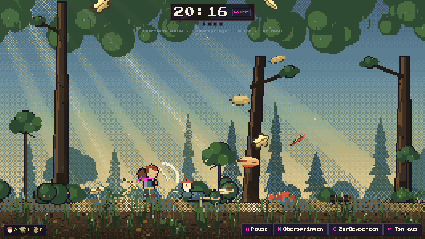
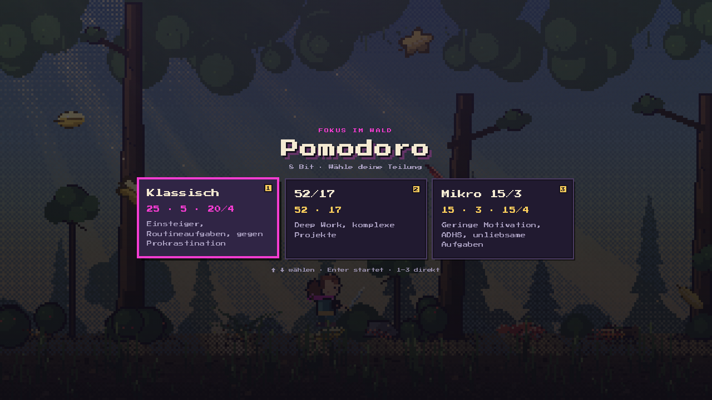
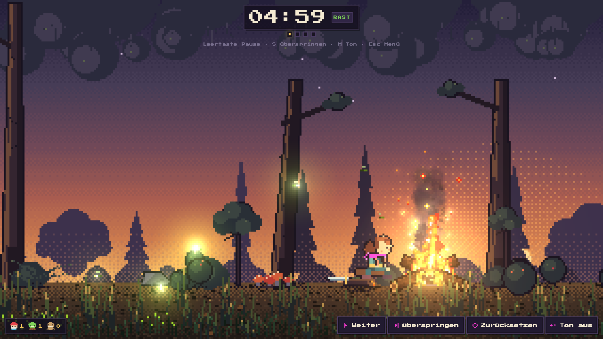
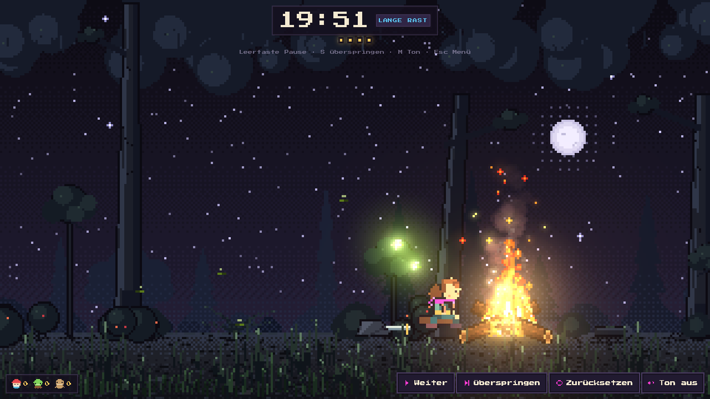

# Pomodoro 8-Bit

Ein Pomodoro-Timer im Pixel-Art-Look: Während du dich konzentrierst, kämpft eine kleine Heldin im Wald gegen Gnome,
Orks und Oger. In der Pause rastet sie am Lagerfeuer. Läuft komplett im Browser, ohne Konto und ohne Backend.

**[▶ Live spielen](https://yamahabenny-gif.github.io/pomodoro-8bit/)** · [Plan und Arbeitspakete](docs/PLAN.md) ·
[Regeln für Agenten](AGENTS.md)



## So läuft eine Session

1. Im Menü eine von drei Teilungen wählen (Maus, `1`–`3` oder Pfeiltasten + Enter).
2. **Kampf** (Fokuszeit): Die Heldin läuft durch den Wald, Gnome, Orks und Oger stellen sich ihr in den Weg. Das
   HUD zeigt Restzeit, Phase, Zyklus-Punkte und wie viele Gegner du heute schon besiegt hast.
3. **Rast** (Pause): Sie geht zum Lagerfeuer und setzt sich. Nach vier Fokuspausen wird die Pause lang und der Wald
   wird Nacht. Danach beginnt der nächste Zyklus – die Heldin steht auf und läuft weiter.

Pause, Weiter, Überspringen und Zurücksetzen gehen jederzeit; der Timer rechnet mit Zeitstempeln, bleibt also auch
im Hintergrund-Tab und nach dem Standby korrekt. Nach einem Reload landet man im Menü; die Wahl derselben Variante
setzt die gespeicherte Session mit korrekter Restzeit fort ([#19](https://github.com/yamahabenny-gif/pomodoro-8bit/issues/19)).
Die Seite funktioniert auf dem Desktop und im Handy-Querformat.

## Varianten

| id | Name | Fokus | Kurze Pause | Lange Pause | Ideal für |
|---|---|---|---|---|---|
| `classic` | Klassisch | 25 min | 5 min | 20 min nach 4 Zyklen | Einsteiger, Routine, gegen Prokrastination |
| `deep` | 52/17 | 52 min | 17 min | keine | Deep Work, komplexe Projekte |
| `micro` | Mikro 15/3 | 15 min | 3 min | 15 min nach 4 Zyklen | geringe Motivation, ADHS, unliebsame Aufgaben |

Weitere Teilungen lassen sich in [`src/config/presets.js`](src/config/presets.js) ergänzen; das Menü rendert die Liste.

## Steuerung

| Eingabe | Wirkung |
|---|---|
| `Leertaste` | Pause / Weiter |
| `S` | Phase überspringen |
| `M` | Ton an / aus |
| `Esc` | Zurück zum Menü (mit Bestätigung) |
| `1` – `3` | Variante im Menü direkt starten |
| `↑` `↓` | Auswahl im Menü |
| `Enter` | Auswahl im Menü starten |

Die Buttons im HUD machen dasselbe mit der Maus oder dem Finger.

<table>
<tr>
<td></td>
<td></td>
</tr>
<tr>
<td align="center">Startmenü</td>
<td align="center">Kurze Pause am Lagerfeuer</td>
</tr>
</table>



## Entwicklung

```sh
npm install
npm run dev        # http://localhost:5173
npm test           # Vitest: Timer, Figuren, Wald, UI, Audio, Regie
npm run build      # Produktionsbuild nach dist/
npm run preview    # gebauten Stand lokal ansehen
```

Für den Browser-Test mit Zeitraffer die URL ergänzen: `?speed=60` macht aus einer Minute eine Sekunde
(`?speed=600` entsprechend eine Zehntelsekunde). Praktisch für Phasenwechsel und Pausen, ohne 25 Minuten zu warten.

### Tests

- `npm test` – Unit-Tests (Vitest, `tests/**/*.test.js`).
- `npm run test:e2e` – Playwright-Smoke-Test gegen den gebauten Stand: Menü → Klassisch → HUD → Phasenwechsel
  Kampf/Rast, ohne Konsolenfehler. Startet `vite preview` selbst; beim ersten Mal einmalig
  `npx playwright install chromium`.
- `node tests/e2e/qa-report.mjs` – DoD-Checkliste im Browser (HUD, Tastatur, Hintergrund-Tab, Reload, Handy-Querformat).
- `node tests/e2e/perf.mjs` – eine Minute fps, Frametimes und JS-Heap.
- `node tools/snap.mjs tools/scenes/forest-fight.mjs snaps/fight.png 2` – rendert eine Szene headless als PNG.

### Deployment

`.github/workflows/ci.yml` prüft Tests und Build bei jedem Push und Pull Request.
`.github/workflows/pages.yml` baut `main` und veröffentlicht `dist/` über GitHub Actions auf
<https://yamahabenny-gif.github.io/pomodoro-8bit/>. `base: "./"` in `vite.config.js` hält die Pfade relativ, damit
der Build unter dem Repository-Unterpfad läuft.

## Aufbau

Vanilla JavaScript (ES-Module), Vite, Vitest – kein Framework. Eine 320 × 180-Pixel-Bühne auf einem Canvas, per CSS
pixelig skaliert, darüber ein DOM-Overlay für Menü und HUD. Jede Moduldatei trägt einen `CONTRACT`-Kommentar mit
ihrer Schnittstelle: Timer, Heldin, Gegner, Wald, Regie, UI und Audio lassen sich so einzeln testen.

```
index.html            Canvas #stage + DOM-Overlay #ui
src/main.js           Boot: Menü -> Timer -> Regie
src/config/presets.js die drei Varianten
src/engine/stage.js   pixelfx-Frame, composite(), rAF-Loop
src/timer/            zeitstempelbasierter Zustandsautomat, localStorage
src/game/heroine/     Heldin: Sprite + Animationen
src/game/enemies/     Gnom, Ork, Oger
src/game/scene/       Parallax-Wald, Lagerfeuer, Tageszeiten
src/game/director/    verbindet Timer-Ereignisse mit der Bühne
src/ui/               Startmenü, HUD, Tastatur
src/audio/            WebAudio-8-Bit-Sounds, Ambience, Notifications
vendor/pixelfx/       vendored, unverändert
tools/snap.mjs        rendert eine Szene headless als PNG
```

## Credits

- Grafik-Engine: [pixelfx](https://github.com/patch-gg/pixelfx) von Patch und Hugo Duprez, MIT, unverändert unter
  [`vendor/pixelfx`](vendor/pixelfx) (siehe dort `LICENSE` und `VENDORED.md`).
- Einzelne Effekte in pixelfx adaptieren [Sprite Fusion](https://www.spritefusion.com/pixel-art-vfx) von Hugo
  Duprez und [Hollow Crown](https://github.com/rehan-remade/hollow-crown) von rehan-remade (beide MIT). Details:
  [`vendor/pixelfx/NOTICE.md`](vendor/pixelfx/NOTICE.md).
- Schrift im UI: [Press Start 2P](https://fonts.google.com/specimen/Press+Start+2P) von CodeMan38, SIL Open Font
  License, über Google Fonts geladen.
- Heldin, Gegner und Wald sind für dieses Projekt neu gezeichnet.
