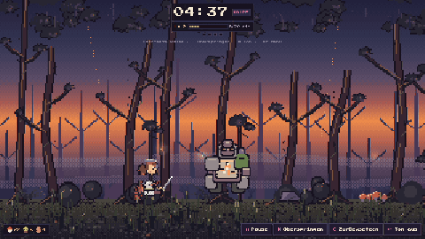
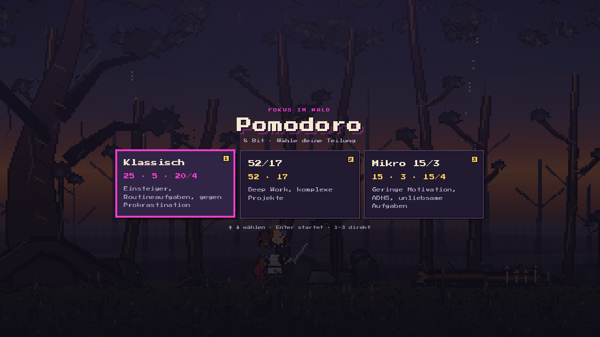
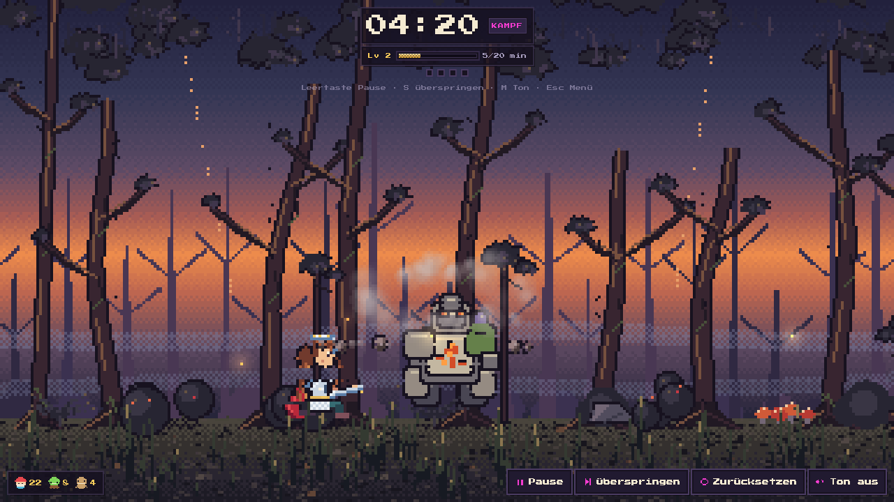
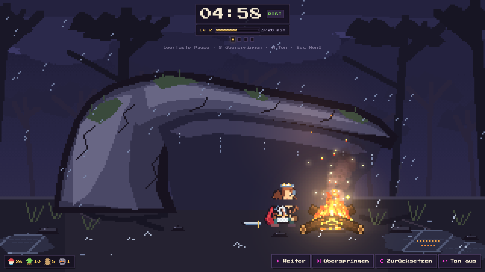
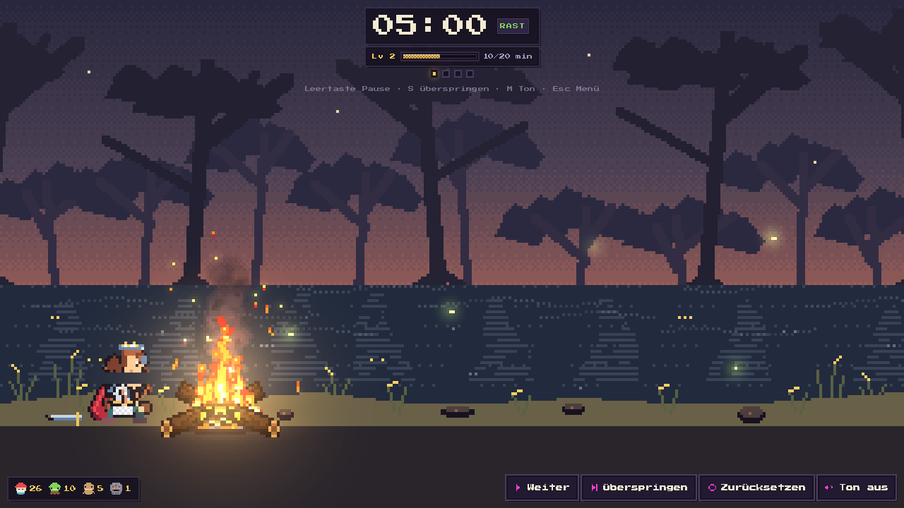
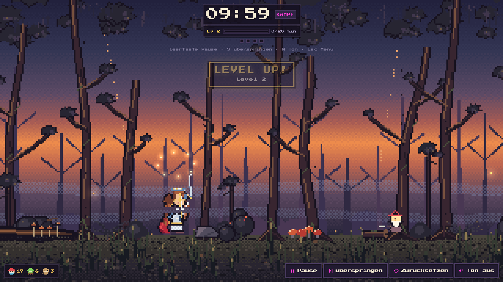
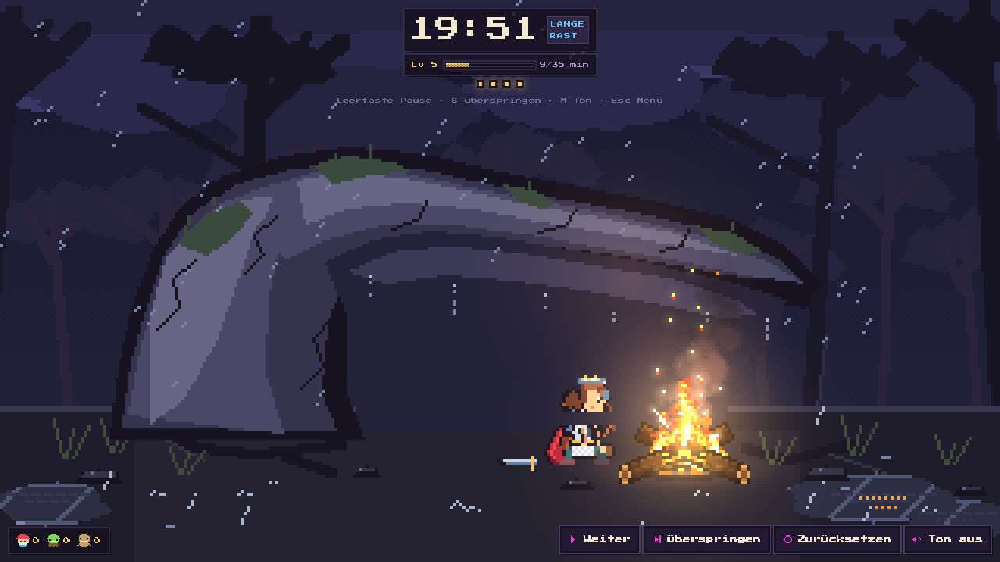

# Pomodoro 8-Bit

Ein Pomodoro-Timer im Pixel-Art-Look: Während du dich konzentrierst, kämpft eine kleine Ritterin im
Dämmerungswald gegen Gnome, Halb-Orks, Oger und einen Steingolem. In der Pause rastet sie im Gewitter-Unterschlupf
oder am See, entzündet ein Feuer und sammelt mit jeder Fokusminute Erfahrung. Läuft komplett im Browser, ohne Konto
und ohne Backend.

**[▶ Live spielen](https://yamahabenny-gif.github.io/pomodoro-8bit/)** · [Plan und Arbeitspakete](docs/PLAN.md) ·
[Regeln für Agenten](AGENTS.md)



## So läuft eine Session

1. Im Menü eine von drei Teilungen wählen (Maus, `1`–`3` oder Pfeiltasten + Enter).
2. **Kampf** (Fokuszeit): Die Heldin läuft durch den Dämmerungswald – vorbei an knorrigen Bäumen, Nebel-Lichtungen
   und einer Bachbrücke. Gnome, Halb-Orks, Oger und spät in der Phase ein Steingolem stellen sich ihr in den Weg.
   Das HUD zeigt Restzeit, Phase, Zyklus-Punkte, die heutigen Siege und die Erfahrungsleiste.
3. **Rast** (Pause): Sie geht zu einem von zwei Plätzen, entzündet Feuer und setzt sich – bei Gewitter unter dem
   Felsvorsprung im Regen, sonst am Lagerfeuer vor dem See mit Glühwürmchen. Nach vier Fokusphasen wird die Pause
   lang und die Szene nächtlich. Danach beginnt der nächste Zyklus: Die Heldin steht auf und läuft weiter.

Pause, Weiter, Überspringen und Zurücksetzen gehen jederzeit; der Timer rechnet mit Zeitstempeln, bleibt also auch
im Hintergrund-Tab und nach dem Standby korrekt. Nach einem Reload läuft die gespeicherte Session automatisch weiter
– auch mitten in Kampf oder Rast. Die Seite funktioniert auf dem Desktop und im Handy-Querformat.

## Features

- **Level-Up:** Jede Fokusminute zählt als Erfahrung. Für Level 2 braucht es 15 Minuten, danach jeweils fünf mehr
  (20, 25, …). Die Leiste im HUD füllt sich mit der Uhr, bei Erreichen blinkt das **LEVEL UP!**-Banner, die Heldin
  reckt das Schwert und ein Fanfaren-Sound spielt. Der Stand bleibt über Reloads erhalten.
- **Rast-Szenen:** Die Pausen wechseln zwischen dem **Gewitter-Unterschlupf** (Regen, entfernte Blitze, sie schlägt
  Feuer unter dem Felsvorsprung) und dem **See** (Glühwürmchen über dem Wasser, Mond und Feuer spiegeln sich). Die
  lange Pause nach vier Zyklen spielt bei Nacht. In beiden Szenen muss sie das Feuer erst entzünden – Funken,
  Rauch, dann Flammen.

### Gegner

Vier Typen mit eigener Taktik, die im Lauf einer Fokusphase härter werden:

| Gegner | Treffer | Verhalten |
|---|---|---|
| Gnom | 1–2 | klein und schnell, rote Zipfelmütze |
| Halb-Ork | 3 | muskulös, Axt und Rundschild, blockt gelegentlich einen Schlag |
| Oger | 5 | groß und langsam, Keule mit Bodenschlag |
| Steingolem | 7 | moosige Schulter, glühende Risse, zerbröselt zu Geröll |

Insgesamt erscheinen pro Fokusphase rund 48 Gegner (etwa zwei pro Fokusminute) – doppelt so viele wie vor dem
Ausbau. Die letzten beiden im letzten Viertel sind Steingolems.

## Varianten

| id | Name | Fokus | Kurze Pause | Lange Pause | Ideal für |
|---|---|---|---|---|---|
| `classic` | Klassisch | 25 min | 5 min | 20 min nach 4 Zyklen | Einsteiger, Routine, gegen Prokrastination |
| `deep` | 52/17 | 52 min | 17 min | keine | Deep Work, komplexe Projekte |
| `micro` | Mikro 15/3 | 15 min | 3 min | 15 min nach 4 Zyklen | geringe Motivation, ADHS, unliebsame Aufgaben |

Weitere Teilungen lassen sich in [`src/config/presets.js`](src/config/presets.js) ergänzen; das Menü rendert die Liste.

## Steuerung

| Eingabe | Wirkung |
|---|---|
| `Leertaste` | Pause / Weiter |
| `S` | Phase überspringen |
| `M` | Ton an / aus |
| `Esc` | Zurück zum Menü (mit Bestätigung) |
| `1` – `3` | Variante im Menü direkt starten |
| `↑` `↓` | Auswahl im Menü |
| `Enter` | Auswahl im Menü starten |

Die Buttons im HUD machen dasselbe mit der Maus oder dem Finger.

<table>
<tr>
<td></td>
<td></td>
</tr>
<tr>
<td align="center">Startmenü</td>
<td align="center">Kampf gegen den Steingolem</td>
</tr>
<tr>
<td></td>
<td></td>
</tr>
<tr>
<td align="center">Rast im Gewitter</td>
<td align="center">Rast am See</td>
</tr>
</table>





## Entwicklung

```sh
npm install
npm run dev        # http://localhost:5173
npm test           # Vitest: Timer, Figuren, Wald, UI, Audio, Regie
npm run build      # Produktionsbuild nach dist/
npm run preview    # gebauten Stand lokal ansehen
```

Für den Browser-Test mit Zeitraffer die URL ergänzen: `?speed=60` macht aus einer Minute eine Sekunde
(`?speed=600` entsprechend eine Zehntelsekunde). Praktisch für Phasenwechsel und Pausen, ohne 25 Minuten zu warten.
Für die späten Gegner (Oger, Steingolem) ist `?speed=4` besser: Der Fokus dauert dann gut sechs Minuten, die Kämpfe
laufen in Echtzeit mit und der Golem erscheint noch vor dem Phasenende.

### Tests

- `npm test` – Unit-Tests (Vitest, `tests/**/*.test.js`).
- `npm run test:e2e` – Playwright-Smoke-Test gegen den gebauten Stand: Menü → Klassisch → HUD → XP-Leiste wächst,
  LEVEL UP!-Banner → Phasenwechsel Kampf/Rast, Rast-Szene mit brennendem Feuer, ohne Konsolenfehler. Startet
  `vite preview` selbst; beim ersten Mal einmalig `npx playwright install chromium`.
- `node tests/e2e/qa-report.mjs` – DoD-Checkliste im Browser: Menü, HUD, XP, Level-Up, alle vier Gegner inklusive
  Golem, beide Rast-Szenen mit Entzünden, lange Rast, Reload in Kampf und Rast, Tastatur, Hintergrund-Tab,
  Handy-Querformat, bekannte Lücken verlinkt. Dauert wegen des Golem-Laufs etwa zehn Minuten.
- `node tests/e2e/perf.mjs` – eine Minute fps, Frametimes und JS-Heap.
- `node tests/e2e/shots.mjs --gif` – erneuert die README-Bilder und das GIF unter `docs/img/issue-31/`.
- `node tools/snap.mjs tools/scenes/forest-fight.mjs snaps/fight.png 2` – rendert eine Szene headless als PNG.

### Deployment

`.github/workflows/ci.yml` prüft Tests und Build bei jedem Push und Pull Request.
`.github/workflows/pages.yml` baut `main` und veröffentlicht `dist/` über GitHub Actions auf
<https://yamahabenny-gif.github.io/pomodoro-8bit/>. `base: "./"` in `vite.config.js` hält die Pfade relativ, damit
der Build unter dem Repository-Unterpfad läuft.

## Aufbau

Vanilla JavaScript (ES-Module), Vite, Vitest – kein Framework. Eine 320 × 180-Pixel-Bühne auf einem Canvas, per CSS
pixelig skaliert, darüber ein DOM-Overlay für Menü und HUD. Jede Moduldatei trägt einen `CONTRACT`-Kommentar mit
ihrer Schnittstelle: Timer, Heldin, Gegner, Wald, Regie, UI und Audio lassen sich so einzeln testen.

```
index.html            Canvas #stage + DOM-Overlay #ui
src/main.js           Boot: Menü -> Timer -> Regie
src/config/presets.js die drei Varianten
src/engine/stage.js   pixelfx-Frame, composite(), rAF-Loop
src/timer/            zeitstempelbasierter Zustandsautomat, localStorage
src/game/heroine/     Heldin: Sprite + Animationen (Ritterin, lightFire, levelUp)
src/game/enemies/     Gnom, Halb-Ork, Oger, Steingolem
src/game/scene/       Dämmerwald-Reise, Rast-Szenen (Gewitter, See)
src/game/progress/    Fokus-XP, Level und XP-Leiste
src/game/director/    verbindet Timer-Ereignisse mit der Bühne
src/ui/               Startmenü, HUD mit XP-Leiste, LEVEL UP!-Banner, Tastatur
src/audio/            WebAudio-8-Bit-Sounds, Ambience, Notifications
vendor/pixelfx/       vendored, unverändert
tools/snap.mjs        rendert eine Szene headless als PNG
```

## Credits

- Grafik-Engine: [pixelfx](https://github.com/patch-gg/pixelfx) von Patch und Hugo Duprez, MIT, unverändert unter
  [`vendor/pixelfx`](vendor/pixelfx) (siehe dort `LICENSE` und `VENDORED.md`).
- Einzelne Effekte in pixelfx adaptieren [Sprite Fusion](https://www.spritefusion.com/pixel-art-vfx) von Hugo
  Duprez und [Hollow Crown](https://github.com/rehan-remade/hollow-crown) von rehan-remade (beide MIT). Details:
  [`vendor/pixelfx/NOTICE.md`](vendor/pixelfx/NOTICE.md).
- Schrift im UI: [Press Start 2P](https://fonts.google.com/specimen/Press+Start+2P) von CodeMan38, SIL Open Font
  License, über Google Fonts geladen.
- Heldin, Gegner und Wald sind für dieses Projekt neu gezeichnet.
