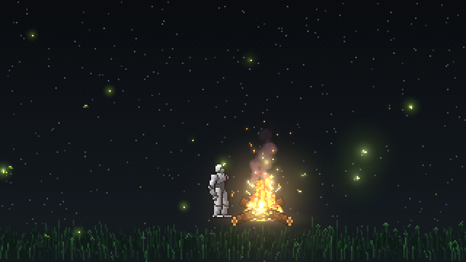

# Pomodoro 8-Bit: Plan



## Idee
Ein Pomodoro-Timer als kleines Pixel-Art-Spiel im Browser. Am Anfang wählt man im Menü die Teilung. Während der
Fokuszeit kämpft eine kleine Heldin im Wald gegen Gnome, Orks und Oger. In der Pause sitzt sie am Lagerfeuer.
Das läuft Zyklus für Zyklus weiter. Der Look kommt aus [pixelfx](https://github.com/patch-gg/pixelfx) (MIT).

Erste Version: nur Web, kein Backend, kein Login.

## Varianten (3 von 5)
| id | Name | Fokus | Kurze Pause | Lange Pause | Ideal für |
|---|---|---|---|---|---|
| `classic` | Klassisch | 25 min | 5 min | 20 min nach 4 Zyklen | Einsteiger, Routine, gegen Prokrastination |
| `deep` | 52/17 | 52 min | 17 min | keine | Deep Work, komplexe Projekte |
| `micro` | Mikro 15/3 | 15 min | 3 min | 15 min nach 4 Zyklen | geringe Motivation, ADHS, unliebsame Aufgaben |

Begründung: die drei decken kurz / mittel / lang ab und unterscheiden sich spürbar. 50/10 und 90/20 sind über
`src/config/presets.js` mit je einem Eintrag nachrüstbar (das Menü rendert die Liste).

## Was man sieht
| Phase | Bühne | Stimmung |
|---|---|---|
| Fokus ("Kampf") | Heldin läuft nach rechts, Wald scrollt; Gegner tauchen auf, Kampf mit Schwert-Kombos, Gegner verpufft, weiter | Tag / Nachmittag, fallende Blätter, Lichtstrahlen |
| Kurze Pause ("Rast") | Übergang, sie geht zum Lagerfeuer und setzt sich | Dämmerung, Lagerfeuer, Glühwürmchen |
| Lange Pause ("Lange Rast") | wie Rast | Nacht, Sterne, größeres Feuer |
| Zurück zum Fokus | sie steht auf, streckt sich, läuft los | |

Die Heldin verliert nie. Gegner werden innerhalb einer Fokusphase härter (Gnom, dann Ork, dann Oger). Am Ende einer
Phase wird kein Kampf abgeschnitten: der Gegner flieht oder verpufft im Übergang. Besiegte Gegner zählen als
Fortschritt im HUD (pro Tag gespeichert).

## Architektur
```
index.html            Canvas #stage (320x180, pixelated) + DOM-Overlay #ui
src/main.js           Boot: Menü -> Timer -> Regie
src/config/presets.js die drei Varianten (fertig)
src/engine/stage.js   pixelfx-Frame, composite(), rAF-Loop (fertig)
src/timer/            Zustandsautomat, zeitstempelbasiert, persistiert, testbar in Node
src/game/heroine/     Heldin: Sprite + Animationen
src/game/enemies/     Gnom, Ork, Oger
src/game/scene/       Wald (Parallax) + Lagerfeuer + Wetter-Stimmungen
src/game/director/    verbindet Timer-Ereignisse mit der Bühne
src/ui/               Startmenü, HUD, Tastatur
src/audio/            WebAudio-8-Bit-Sounds, Notifications
vendor/pixelfx/       vendored, unverändert
tools/snap.mjs        rendert eine Szene headless als PNG
```
Jede Moduldatei trägt einen `CONTRACT`-Kommentar mit der genauen Schnittstelle. So können alle Module parallel
gebaut werden, die Regie fügt sie danach zusammen.

### Timer-Regeln
- Wanduhr-basiert (`endsAt`), nie aus Frame-Deltas. Hintergrund-Tabs und Standby bleiben korrekt.
- Ereignisse `phase`, `end`, `change`. Pause/Weiter/Überspringen/Zurücksetzen.
- Persistenz in `localStorage`, Wiederherstellung nach Reload (abgelaufene Phasen werden korrekt übersprungen).
- `?speed=60` als Debug-Parameter (eine Minute = eine Sekunde) für Tests und Demos.

### Wiederverwendete pixelfx-Effekte
`fire/campfire`, `weather/fireflies`, `weather/falling-leaves`, `weather/god-rays`, `melee/sword-slash`,
`melee/double-slash`, `impacts/hit-spark`, `impacts/blunt-hit`, `impacts/ground-slam`, `spawn/poof`,
`spawn/soul-rise`, `ui/coin-collect`, `transitions/iris`. Heldin und Gegner werden neu gezeichnet (eigene Sprites
oder über `rig.js`), weil pixelfx nur einen männlichen Stock-Helden und eine Übungspuppe mitbringt.

## Arbeitspakete
| # | Paket | Worker | Modell | hängt ab von |
|---|---|---|---|---|
| 1 | Fundament (dieser Commit) | Claude (Koordinator) | Opus 5.5 | – |
| 2 | Timer-Kern | OpenCode | `opencode/deepseek-v4.1-flash` | 1 |
| 3 | Heldin | Codex (OpenAI-Abo) | `gpt-6-luna` | 1 |
| 4 | Gegner: Gnom, Ork, Oger | Codex (OpenAI-Abo) | `gpt-6-luna` | 1 |
| 5 | Wald & Lagerfeuer | OpenCode | `opencode/deepseek-v4.1-flash` | 1 |
| 6 | UI: Menü & HUD | OpenCode | `opencode/deepseek-v4.1-flash` | 1 |
| 7 | Sound & Benachrichtigung | OpenCode | `opencode/deepseek-v4.1-flash` | 1 |
| 8 | Regie (Integration) | Codex (OpenAI-Abo) | `gpt-6-luna` | 2–7 |
| 9 | QA, Deploy, README | OpenCode | `opencode/deepseek-v4.1-flash` | 8 |

Faustregel: große, kreative oder verzahnte Aufgaben (Pixel-Art-Figuren, Integration) an GPT-6 über Codex; klar
umrissene Logik- und UI-Pakete an DeepSeek V4.1 Flash über OpenCode.

### Ablauf
1. **Welle 1** (parallel): 2, 3, 4, 5, 6, 7. Jeder Worker in eigenem Orca-Worktree mit eigenem Branch, PR gegen `main`.
2. Koordinator prüft jede PR (Tests, Build, Snapshots ansehen), merged oder schickt Korrekturen an den Worker.
3. **Welle 2**: 8 (Regie) auf dem gemergten Stand.
4. **Welle 3**: 9 (QA & Deploy), danach ein Abschluss-Review durch Codex.

## Definition of Done (MVP)
- Menü mit drei Varianten, Start, HUD mit Restzeit, Phase, Zyklus-Punkten, Kill-Zähler.
- Fokus: Kampfszenen laufen über die ganze Phase, alle drei Gegnertypen kommen vor.
- Pause: Heldin am Lagerfeuer; lange Pause bei Nacht.
- Pause/Weiter/Überspringen/Zurücksetzen, Tastaturkürzel, Stummschalten.
- Ton und Browser-Benachrichtigung am Phasenende.
- Korrekte Zeit bei Hintergrund-Tab und Reload.
- `npm test` grün, `npm run build` grün, läuft auf Desktop und Handy (Querformat), CI grün.
