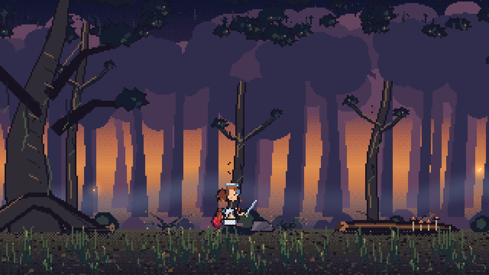
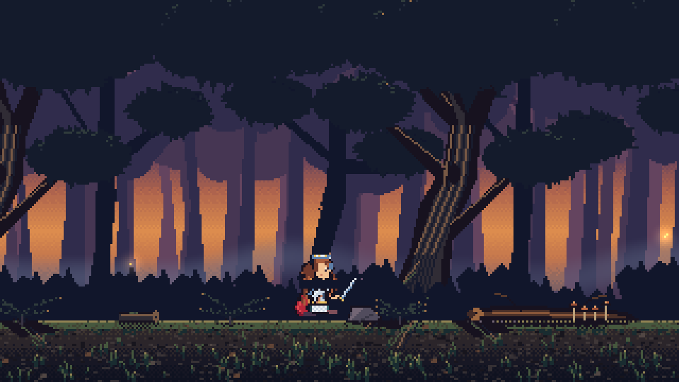
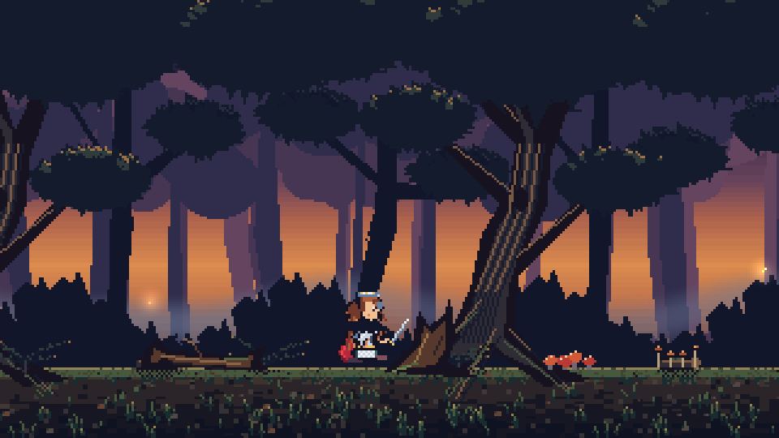
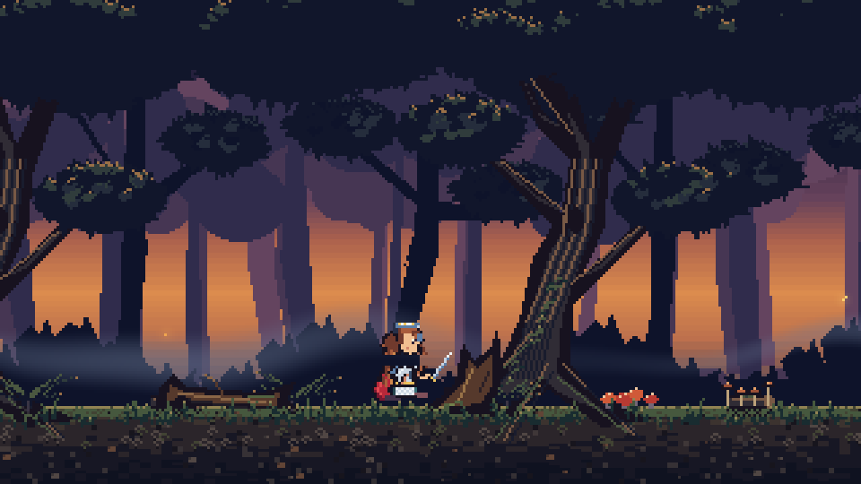
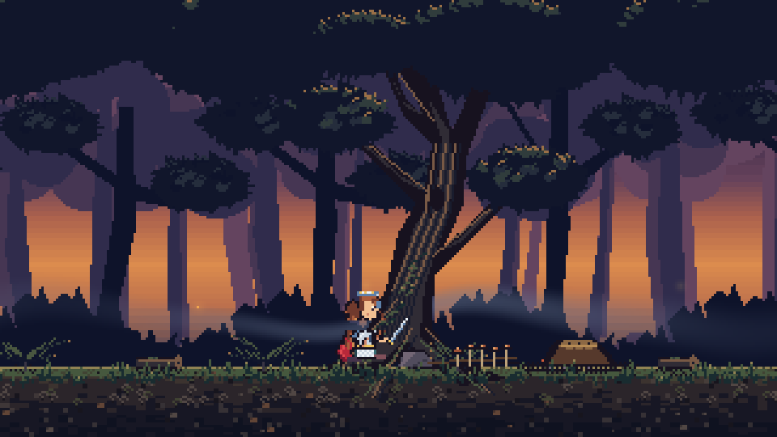
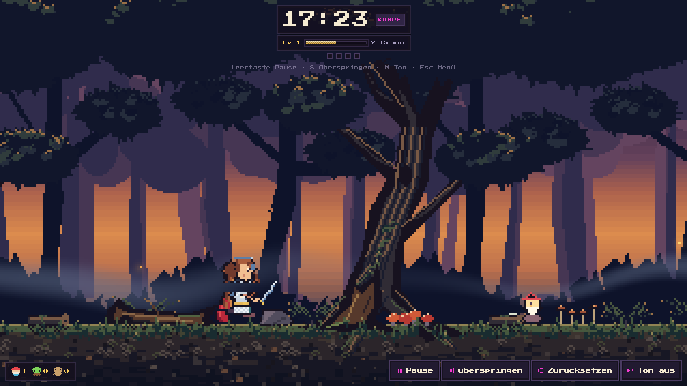

# Vergleichsrunden – Issue #49

Die Referenz wurde mit `sips -Z 320` auf Bühnenmaßstab betrachtet und im Bildwerkzeug neben die Snapshots gelegt. Die Komposition liest sich von oben nach unten als dunkles Blätterdach, violettblaue Ferne vor einem waagrechten orangefarbenen Lichtband, weiche blau-graue Schwaden im unteren Drittel und ein moosiger Boden. Die Lichtkante liegt hinter den Bäumen; die Baumränder und Wurzeln sind warm beleuchtet. Wichtige, visuell abgenommene Referenzfarben (gerundet): `#090d20`, `#11152c`, `#1b2034`, `#27253c`, `#332943`, `#40304d`, `#51415c`, `#68516a`, `#795c70`, `#9b5c4d`, `#be6746`, `#dc7843`, `#ed9148`, `#777d9a`, `#4d5a72`, `#303344`, `#282b2d`, `#55523d`, `#73734b`, `#a17b4a`.

## Runde 1

Abweichungen zur Referenz: zu viele Y-förmige Äste und gerade Stämme; Kronen wirkten wie einzelne dunkle Blöcke. Der Vordergrund war eine hohe Graswand und verdeckte Figuren. Der Boden hatte keine klar lesbare Erdschicht. Diese Runde bestätigte die Probleme des Live-Bildes.

## Runde 2

Abweichungen zur Referenz: breitere, knorrige Hauptsilhouette und mehr Wurzeln, aber die Fernebene war noch zu regelmäßig und die Laubkronen zu rund. Es gab noch keine Schwaden; die Heldin wirkte durch die unveränderte Sprite-Zeichnung getrennt. Die Formen der dichten Farn- und Bodenschicht waren bereits näher am Ziel.

## Runde 3

Abweichungen zur Referenz: Laubmassen, Baumstumpf und Erdprofil geben eine klarere Tiefenstaffelung. Das Orangeband war noch zu hell und gleichmäßig; die Baumstämme erschienen als lange, glatte Pfosten. Die Nebelbänder fehlten noch, sodass der untere Wald zu offen blieb.

## Runde 4

Abweichungen zur Referenz: Nebel liegt nun zwischen den Stämmen und ausschließlich unterhalb von `y=108`. Die Schwaden waren noch schmal und gleichmäßig; die Fernsilhouetten hatten zu wenige, zu große Kronen. Die sichtbare Lücke im Heldinnen-Sprite bestand weiter.

## Runde 5

Abweichungen zur Referenz: gezacktere Kronen, mehr warme Blattkanten und fleckigere, breitere Nebelschwaden verbessern Form und Tiefe. Einzelne Fernstämme bleiben geometrisch und die große Mittelebene konkurriert stellenweise mit der Heldin. Die Wald-Vordergrundpassage ist oberhalb der niedrigen Grasfranse frei.

## Runde 6 – aktueller Stand

Abweichungen zur Referenz: die orange Dämmerungsachse, die violettblaue Ferne, die breite knorrige Mittelebene, Bodennebel und Erdschicht sind klar lesbar. Die Fernbäume sind weiterhin gröber und regelmäßiger als die feine Referenzpixel-Art; die Laubkronen und Wurzeln könnten noch mehr kleine warme Akzente tragen. Die Heldin überlagert den Baum korrekt, aber ihr Sprite enthält in der Laufpose leere Zeilen zwischen Kopf und Körper (siehe Browserbefund); das liegt außerhalb dieses Issue-Bereichs.

## Browserbefund (`?speed=60`)

Mit `npm run dev -- --host 127.0.0.1 --port 4249` und `node tools/scenes/forest-browser-check.mjs` wurden drei Zeitpunkte erfasst. Es gab keine Browserfehler. Der Ebenentest fand `0` Vordergrundpixel oberhalb von `y=148`; Nebel und Baumebenen werden in `drawBack` vor den Figuren gezeichnet. Die Laufpose meldet leere Sprite-Zeilen `12–15` und `29–31`, was die sichtbare Kopf-Körper-Lücke erklärt.

